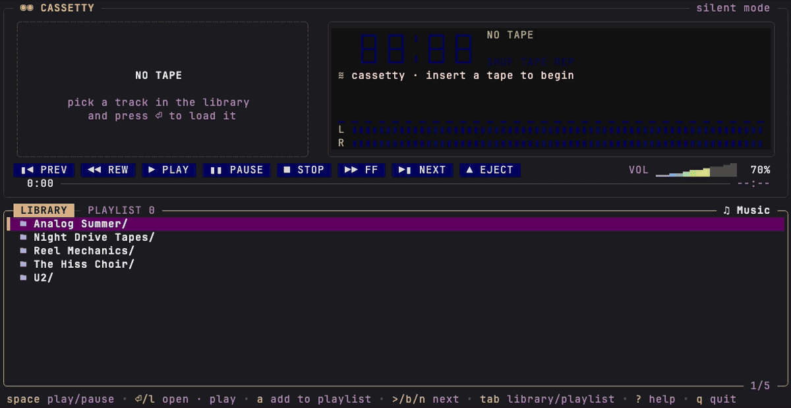
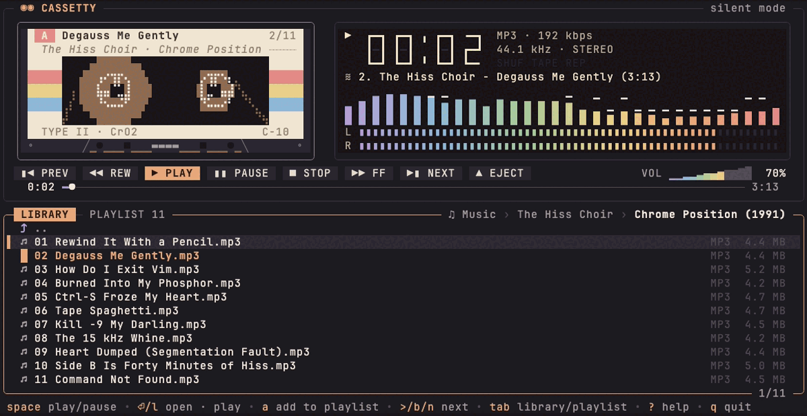
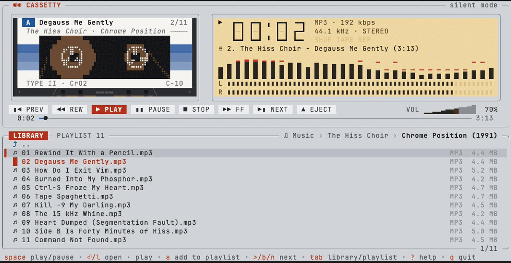
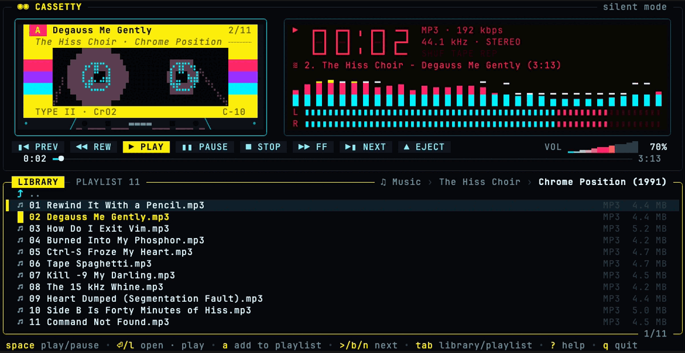
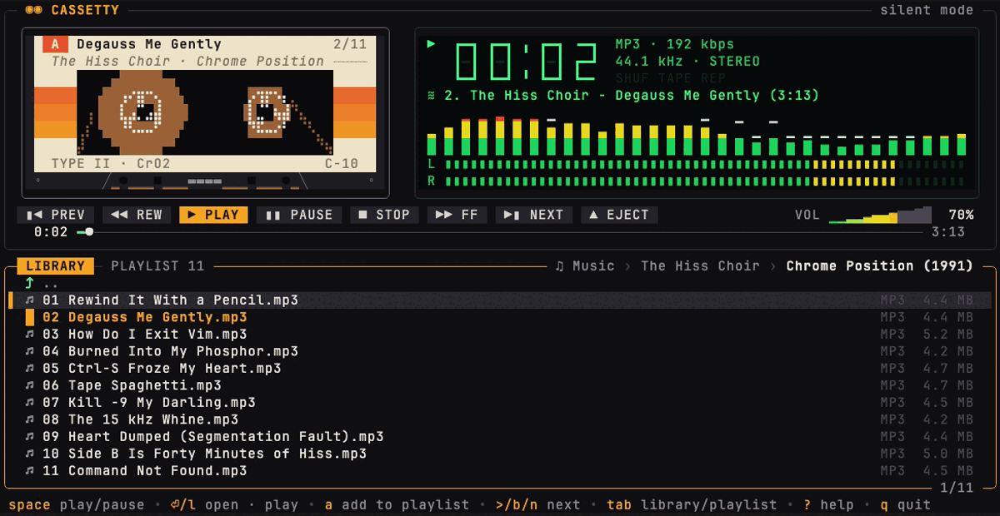
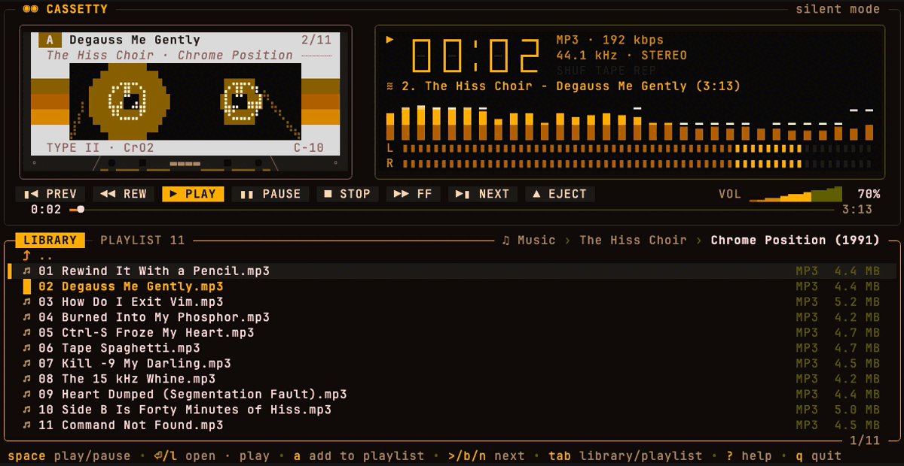
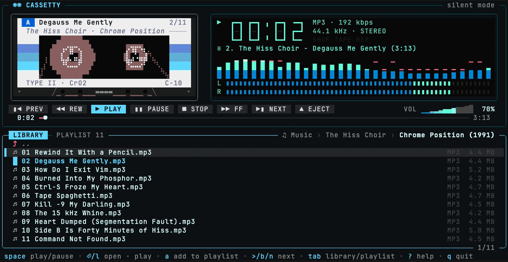
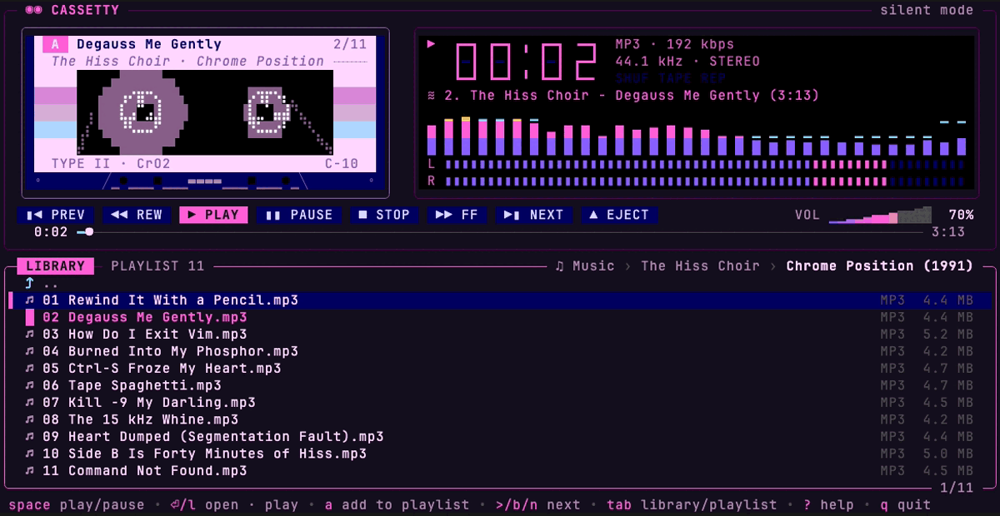

<p align="center">
  
</p>

<p align="center">
  <a href="https://github.com/samuelb/cassetty/releases/latest"></a>
  
  
  <a href="LICENSE"></a>
  <a href="https://github.com/samuelb/cassetty/actions/workflows/ci.yml"></a>
</p>

<p align="center">
  <b><a href="https://cassetty.io">Website</a></b> ·
  <a href="#install">Install</a> ·
  <a href="#usage">Usage</a> ·
  <a href="#keys">Keys</a> ·
  <a href="#skins">Skins</a> ·
  <a href="#configuration">Configuration</a>
</p>

<p align="center">
  
</p>

A cassette deck music player for your terminal.

Built with [Bubble Tea v2](https://github.com/charmbracelet/bubbletea),
[Lip Gloss](https://github.com/charmbracelet/lipgloss) and
[beep](https://github.com/gopxl/beep). Runs on macOS and Linux, controlled by
keyboard and mouse.

## Install

### Download

Grab the archive for your machine from the
[latest release](https://github.com/samuelb/cassetty/releases/latest), unpack
it and put `cassetty` somewhere on your `PATH`:

| | Apple Silicon · ARM64 | Intel · x86-64 |
|---|---|---|
| **macOS** | [cassetty_darwin_arm64.tar.gz](https://github.com/samuelb/cassetty/releases/latest/download/cassetty_darwin_arm64.tar.gz) | [cassetty_darwin_amd64.tar.gz](https://github.com/samuelb/cassetty/releases/latest/download/cassetty_darwin_amd64.tar.gz) |
| **Linux** | [cassetty_linux_arm64.tar.gz](https://github.com/samuelb/cassetty/releases/latest/download/cassetty_linux_arm64.tar.gz) | [cassetty_linux_amd64.tar.gz](https://github.com/samuelb/cassetty/releases/latest/download/cassetty_linux_amd64.tar.gz) |

Or pick the right one from a shell:

```sh
curl -fsSL https://github.com/samuelb/cassetty/releases/latest/download/cassetty_$(uname -s | tr A-Z a-z)_$(uname -m | sed 's/x86_64/amd64/;s/aarch64/arm64/').tar.gz | tar xz cassetty
sudo mv cassetty /usr/local/bin/
```

> [!NOTE]
> The macOS binaries are not notarized. If you downloaded the archive with a
> browser, clear the quarantine flag once:
> `xattr -d com.apple.quarantine cassetty`

### With Go

Requires Go 1.26 or newer.

```sh
go install github.com/samuelb/cassetty@latest
# or from a checkout
go build -o cassetty . && ./cassetty ~/Music
```

No cgo is required, so cross compiling is a plain
`GOOS=linux GOARCH=arm64 go build`.

**Linux:** audio goes through PulseAudio (also PipeWire's pulse server) and
falls back to ALSA (`libasound.so.2`, loaded at runtime). Without a usable
sound device cassetty starts in silent mode and tells you so.

## Formats

Decoded natively, no external tools needed: **MP3, FLAC, WAV, Ogg Vorbis**.

If [`ffmpeg`](https://ffmpeg.org) is on your `PATH`, cassetty also plays
**M4A/AAC/ALAC, Opus, AIFF, WMA, APE, WavPack, MKA, AC3, CAF**, and Ogg files
that hold Opus or FLAC. Tracks are resampled to 44.1 kHz.

Playback is gapless: cassetty opens the next track while one plays and rolls
straight on to it, so live albums and DJ mixes play without a pause between
the tracks.

## Usage

```
cassetty [flags] [music folder]

  -dir string       music folder (overrides music_dir from the config)
  -theme string     sunbleached (default), classic, amber, vfd, synthwave, silverface, cyberdeck
  -config string    config file path
  -init-config      write a commented default config file and exit
  -silent           do not open the audio device
  -version          print the version
```

The folder argument wins over the config file; without either cassetty opens
`~/Music`, or the current folder if there is no `~/Music`. The browser never
leaves that root folder.

## Keys

| Playback | | Library | |
|---|---|---|---|
| `space` `p` | play / pause | `↑↓` `jk` | move (`pgup` `pgdn` `g` `G`) |
| `s` `v` | stop | `enter` `l` | open folder · play track |
| `<` `>` | previous · next (`z` `b` `n`) | `backspace` `h` `~` | parent folder · root |
| `←` `→` | seek 5 s | `a` | add to playlist |
| `shift+←` `shift+→` | seek 30 s (`[` `]`) | `A` | play, replacing playlist |
| `+` `-` | volume | `/` | filter, `esc` clears |
| `m` | mute | `F` | search the whole library |
| `e` | eject | `f` | find the playing track |

| Playlist | | Modes | |
|---|---|---|---|
| `tab` `1` `2` | library · playlist | `S` | shuffle |
| `enter` | play selected | `r` | repeat off · all · one |
| `d` `x` | remove | `i` | elapsed · remaining |
| `c` | clear all | `T` | tape sound |
| `K` `J` | move up / down | `t` | next theme |
| | | `?` | all keys |
| | | `q` | quit |

`/` filters the folder you are in. `F` searches the whole library instead: it
matches the words you type against the paths of the folders and files below
the music folder, so `floyd wall` finds the folder *Pink Floyd/The Wall* and
its tracks. `tab` switches between the two while you type. `enter` on a track
plays its folder from that track, as in the browser, and `esc` goes back to
the folder you were in. Each search reads the library afresh, so it finds
what you added since.

On macOS the media keys work too, as do headphone buttons and the Now
Playing widget in Control Center, which shows the playing track and can seek
in it. macOS sends them to the app that played last, so cassetty takes them
over once it plays a track.

On Linux cassetty is an [MPRIS](https://specifications.freedesktop.org/mpris-spec/latest/)
player: the media keys, the media widgets of GNOME, KDE Plasma and other
desktops, and `playerctl` show the playing track, seek in it, and set the
volume, shuffle and repeat.

## Tape sound

Press `T` to hear the music come off a cassette: the tape wows and flutters,
hisses quietly, saturates a little and loses some treble. How much depends on
the tape type printed on the label, which follows the file: lossless files
play from metal tape (type IV), MP3, Ogg and Opus from chrome (type II) and
everything else from normal tape (type I), which hisses the most. Pausing
winds the tape down and playing winds it up again. cassetty remembers the
setting; with it off, the decoded audio plays unchanged.

## Skins

Press `t` to cycle, pass `-theme`, or set `theme` in the config.

<table>
  <tr>
    <td width="50%"><br><b>sunbleached</b> · faded rainbow (default)</td>
    <td width="50%"><br><b>silverface</b> · brushed aluminium hi-fi</td>
  </tr>
  <tr>
    <td><br><b>cyberdeck</b> · yellow, magenta and cyan on black</td>
    <td><br><b>classic</b> · green LCD</td>
  </tr>
  <tr>
    <td><br><b>amber</b> · amber monochrome</td>
    <td><br><b>vfd</b> · cyan vacuum fluorescent display</td>
  </tr>
  <tr>
    <td><br><b>synthwave</b> · neon pink and blue</td>
    <td></td>
  </tr>
</table>

## Configuration

`~/.config/cassetty/config.toml` (or `$XDG_CONFIG_HOME/cassetty/config.toml`,
or `$CASSETTY_CONFIG`). Create a commented one with `cassetty -init-config`:

```toml
music_dir = "~/Music"      # root of the library (unset: ~/Music, else the current folder)
# themes: sunbleached, classic, amber, vfd, synthwave, silverface, cyberdeck
theme = "sunbleached"      # always start in this theme (unset: the last one used)
volume = 70                # initial volume in percent
show_hidden = false        # list dot files and folders
paint_background = true    # paint the terminal background in the theme color (silverface always does)
seek_step = 5              # seconds for ←/→ (shift = 6x)
```

cassetty picks up where you left off: it remembers the playlist, the track
in the deck and how far into it you were, and the next start loads that
track paused at that point, so `space` plays on. It also remembers the
volume, skin, shuffle, repeat, tape sound and the last folder. That state
lives in `~/.local/state/cassetty/state.json` (or
`$XDG_STATE_HOME/cassetty/state.json`) and is saved when cassetty quits,
also when its terminal window is closed.

## Development

```sh
go test ./...
# open every file of a real library, and render reports
CASSETTY_TEST_MUSIC=~/Music go test ./internal/audio ./internal/ui -v
# exercise the sound device (at zero volume)
CASSETTY_TEST_DEVICE=1 go test ./internal/audio -run TestDevice
# publish a track to the macOS Now Playing widget and withdraw it (on Linux,
# go test drives the MPRIS player on a private dbus-daemon of its own)
CASSETTY_TEST_NOWPLAYING=1 go test ./internal/nowplaying -run TestSession
# write cassette renderings to a file for eyeballing
CASSETTY_PREVIEW=/tmp/cassette.ans go test ./internal/ui -run TestCassettePreview && cat /tmp/cassette.ans
```

Layout: `internal/audio` (decoding, the always-running deck streamer and
its tape transport, oto output, sample tap), `internal/viz` (FFT spectrum and VU ballistics),
`internal/library` (folder listing, natural sort, recursive collection,
tags), `internal/watch` (watches the shown folder with one kqueue/inotify
handle; no per-file descriptors), `internal/nowplaying` (media keys: the
macOS Now Playing widget through MediaPlayer, via purego, and MPRIS over
D-Bus elsewhere), `internal/ui`
(Bubble Tea model; `cassette.go`, `lcd.go`, `controls.go`, `browser.go`
render the parts, `live.go` keeps the shown folder current,
`remote.go` answers the media keys), `internal/config`.

**Website and demos.** `docs/` is the GitHub Pages site, deployed by
`.github/workflows/pages.yml`; its skin colors come from
`internal/ui/theme.go`. `scripts/demo/record.sh` re-records the videos,
screenshots and `demo.gif` in `docs/media` with
[vhs](https://github.com/charmbracelet/vhs), playing a generated library.

**Releases.** The Release workflow (`.github/workflows/release.yml`) is
started by hand. It runs the tests, lets [git-cliff](https://git-cliff.org)
pick the next version from the
[Conventional Commits](https://www.conventionalcommits.org) since the last
tag (or applies the bump you choose), builds the macOS and Linux archives for
amd64 and arm64, then tags the commit and publishes a GitHub release with
notes, checksums and build provenance. A dry run builds everything without
publishing.

```sh
gh workflow run release.yml -f bump=auto -f dry_run=true
# the same archives, locally (on macOS, which re-signs the macOS binaries)
scripts/release-build.sh v0.0.0-dev dist
```

## License

Copyright 2026 Samuel Barabas. Licensed under the [Apache License, Version 2.0](LICENSE); see also [NOTICE](NOTICE).
